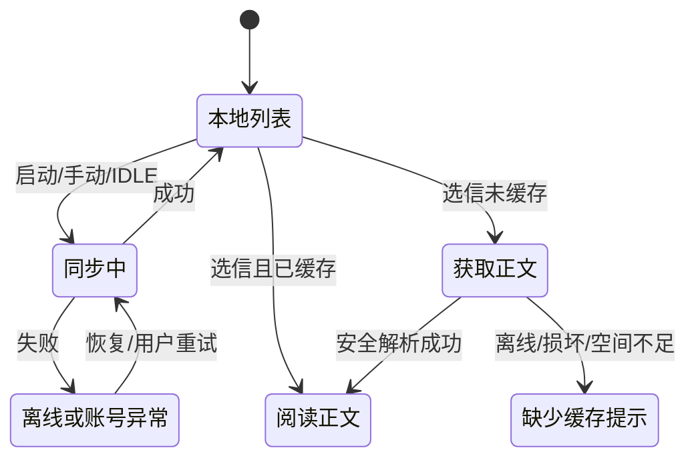
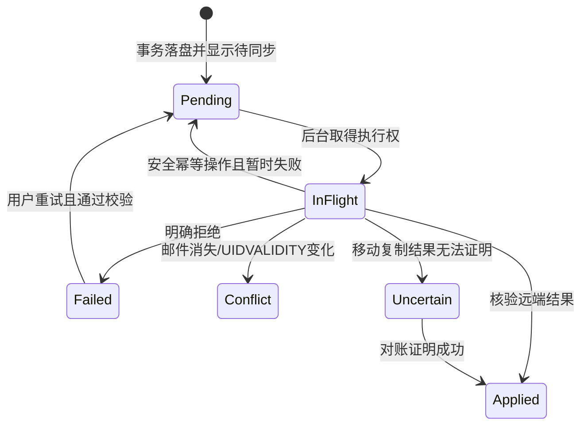

# 多账号、离线与 IPC 规格（P3设计及实施边界）

设计起始：2026-11-17；整理：2026-11-18。本规格保留P3确定的边界及各部分实际实现参数，P3已获用户验收。当前开发源码已由ADR-0009/0010升级为IPC v4，数据库为schema21（1.0.0包仍为schema19 / IPC v2）；下文v1/schema8～17仅指当时设计来源或具体迁移节点，不是当前运行版本。当前状态与实测范围分别见 [项目状态](../项目状态.md)、[验证记录](../验证记录与已知限制.md)。实现补充明确覆盖前文对应设计建议；未实现的合并优化等建议不自动成为新增待办。

## 1. 范围与复用

P3 顺序：设计冻结→单账号 daemon 拆分→多账号/统一收件箱→离线队列→分段资源→双向服务器草稿→缓存/集中验收。按轮报告并提交，门禁 fmt/check/clippy及相关过滤测试。按用户最新要求，仅P3/P4整阶段收口运行全量测试；拆分后、P3收口各做一次集中端到端。

复用 `mail-storage` 单写者、`mail-service` TLS/IMAP/SMTP、`sending` 一次发送许可、`mail-content` 清理与受控 Draft、现有 M3E 列表/Reader/Composer。UI 不重新实现网络或数据库。核心账号与邮件标识不改变。依赖锁版本不升级。

P3设计时将通知、自启动、Arch安装包和性能专项留给P4；它们现已实现。微软OAuth已在后续源码实现（ADR-0010），真实兼容待验收，Gmail继续延后；不增加联系人、AI、会话聚合、日历、PGP、通用移动撤销或整套 GUI 重设计。现有托盘迁入 daemon。真实外发仍需用户授权。

## 2. 进程与启动关闭

生产运行目录为 `$XDG_RUNTIME_DIR/qingmail`（0700），daemon 锁与 `daemon.sock`（0600）；兼容旧数据目录，不复用 P0 激活协议。只接受同 UID peer。隔离探针必须同时隔离 data/runtime，不继承真实账号。

UI 查找 daemon→缺失时启动同目录二进制→有界等待就绪→Hello→AttachUi→Snapshot。已有 UI 会话时转发 Activate，第二个 UI 退出；后台合并启动同步请求。主窗口关闭先保存内嵌编辑器（拆分设计初期为多编辑窗口），保存成功后结束 GPUI；保存失败不关。后台不因 socket EOF 或 UI 崩溃退出。UI 重开从后台快照恢复，不依赖旧 UI 对象。

托盘打开激活或启动 UI。明确退出走 PrepareShutdown，UI 保存后 FinishShutdown；保存失败取消退出，发送中等待已有限期的提交阶段结束。无 UI 时后台直接在安全点退出。无托盘宿主向 UI 返回具体状态和“再次启动重开/命令行退出”入口。无无限重启守护，无自动配置桌面服务。

## 3. IPC控制及资源通道（当前v2）

权威可编译类型：`crates/mail-protocol/src/lib.rs`、`domain.rs`；线格式：`wire.rs`。protocol 只依赖领域/内容值类型，不依赖存储、网络或 GPUI。storage 重导出原类型路径，减少上层重复改写。

控制请求：`{version:2,id:32位小写hex,command:{type,args}}`，响应：`{version:2,id,result:{Ok:值}|{Err:{code,message}}}`。成功值是带 type/data 的 Reply 枚举；错误使用稳定 ErrorCode。具体外部 serde 表达以 round-trip 测试为准。命令 snake_case，未知字段/命令拒绝。Hello 返回版本和当前支持命令集合，未接入命令明确 Unsupported，不伪装成功。

接口组：

| 组 | 请求与结果 |
| --- | --- |
| 生命周期/状态 | Hello、Status、Attach/Heartbeat/DetachUi、Activate、Prepare/FinishShutdown；结果含 daemon PID、UI 会话、托盘/同步/发送状态 |
| 快照/事件 | Snapshot、Events(after)；返回 revision、有限事件、resnapshot；队列落后重新快照 |
| 账号 | Accounts、CheckAccount(account?,settings,credential_ref)、AccountCheckStatus(task)、CommitAccount(check,account?)、SetDefaultAccount、AccountOptions、AccountImpact、RemoveAccount |
| 索引/同步 | Catalog、Folders、FolderCache、UnifiedInbox、Search、SyncNow、SyncHistory、PauseSync |
| 阅读/资源 | ReadMessage、DownloadAttachment、CancelResource、ReadResource、CreateUpload/WriteResource/FinishUpload |
| 草稿/发送 | Open/New/List/Select/SaveDraft、AttachmentInfos、Review/ConfirmSend、Tasks、RetryCopy、Resend、StopUncertain |
| 离线/草稿冲突 | Enqueue/Retry/ResolveOperation、Operations、DraftSyncFolder、DraftConflicts、ResolveDraftConflict |
| 缓存/浏览器 | CacheStatus、SetCacheBudget、ClearCache、BrowserCopy、AllowRemoteImages、ClearBrowserCopies |

控制帧最大 2 MiB（包括换行）；列表单页 1–200，批操作最多200封，附件引用最多32个。单连接读取控制帧5秒、写入5秒；长任务先确认任务 ID，通过事件/查询跟踪，不能无限占用请求线程。连接数与任务队列均有上限，满时 Busy。

每个资源传输使用独立连接：先 NDJSON ReadResource/WriteResource 请求和 ResourceChunk 响应，然后严格 length 个二进制字节。单块≤64 KiB。接收端不越界读取；完成校验后才发布资源。offset/资源归属/长度校验由 daemon 负责，不接受路径、任意 URL、可执行命令。资源 ID 不等于路径；资源任务 ID 与每封邮件四元定位关联。

版本在命令解码与执行前检查。不兼容一律 VersionMismatch。响应 ID 必须匹配；请求超时不意味着执行回滚。控制日志不打印 payload/凭据/邮件原文。保持错误 code 稳定，message 用于展示。

写操作 request.id 是持久幂等键，记录操作类型、参数摘要和结果。重复同 ID 同参数查询/返回原结果；异参数 Conflict。发送等外部副作用必须先留任务及幂等关联再联网，状态未知返回 Uncertain，不把未完成记录删除重跑。重连先 MutationResult，再恢复 UI，客户端不自动重放发送。普通只读请求可重试。ReviewSend 使用 daemon 保存的短时 token，绑定账号/草稿版本/配置和附件；Confirm 仍重新校验原状态机。

快照 revision 与数据在同一服务串行序列中采集。事件仅为失效通知，不代替数据库；有限队列上限256，溢出发 resnapshot，UI 重新读取状态。新 daemon epoch 或版本倒退也重取快照；不沿用旧游标推测成功。

## 4. 凭据与账号归属

密码输入后只写 Secret Service 临时项（application/purpose=credential-staging-v1/ref/created）；IPC 仅传随机 ref。daemon 检查临时项属性，取凭据并执行连接验证，生成绑定 settings/目标账号的短期 check token。Commit 重新校验 token，创建或更新账号；旧凭据在新凭据与数据库提交确认前保留，失败可恢复。启动清理仅限本应用过期 staging 项，不删除正式账号项。没有 Secret Service 时明确失败，无明文文件或命令行回退。UI 唯一秘密操作是输入和 staging，不直接进行邮件网络认证。

P3-002b 具体化：staging 有效期15分钟；CheckAccount 立即返回 AccountCheckPending(task)，AccountCheckStatus 查询待完成或 AccountCheckResult。单独1个检查线程、最多2个等待任务、16条短期结果，控制线程不等待认证。检查结果/token 5分钟过期，绑定原配置/目标账号及实际验证的凭据；检查不创建账号、不产生发送许可，不需要以新请求重跑来恢复丢失响应。失败不提供提交令牌，成功令牌单次消费。检查接口不能当作保存成功。

P3-002c 具体化：检查令牌同时绑定检查前的账号配置及活动凭据键。CommitAccount 由独立单线程、最多2个等待任务执行；持久取得请求执行权后返回 InProgress，后续查询原请求。每次写独立随机正式凭据键，schema10 将配置、活动引用与成功结果同事务提交，提交前再次校验基线。失败不覆盖旧键；数据库证明新键无引用才允许清理，结果不确定则保留。已完成请求只返回原结果；中断请求不自动执行。正式旧版本保留到显式移除账号。P3-002 当轮曾限制单远端账号，P3-003 已解除；隔离CLI仍不启用密钥库或邮件网络。

列表/草稿/资源/操作/任务全程携带账号 ID；IMAP 定位必须包括 account/folder_id/UIDVALIDITY/UID。跨账号相同 UID 或 Message-ID 不合并。账号删除先列影响，远端不删；有在途任务先协调，不删除仍被任务引用的数据。

P3-002d 曾以进程内桥接过渡；P3-002f 已改为正式Unix Client端点，daemon独占存储线程，复用相同AccountGateway账号命令处理。账号页仅写 staging 并传引用，检查完成后只保留 token/非秘密配置，并尽力清理临时项。前台提交前持久化请求ID书签（私有目录、单写锁、fsync+原子替换），重启只恢复查询，不恢复写请求。查询失败/NotFound/Uncertain 不自动清除；明确结果后清除，或者由用户核对账号后显式结束查询（后台有活动提交时禁用）。书签不含密码、检查令牌或完整请求；存于独立前台目录，不更改 schema10。正式 socket 已复用相同工作流的 Client 端点。

## 5. 多账号与交互状态

左侧保持直角树：统一收件箱（多账号显示）→账号 A/子文件夹→账号 B/子文件夹→发送任务→设置。每账号独立折叠、文件夹位置和错误提示。统一列表按 received_at DESC、account DESC、message_id DESC 的稳定 keyset 分页，使用完整定位选择邮件。列表行附账号标签，不跨账号 MOVE。

回复来自原邮件账号；统一收件箱新建用可见默认账号；普通文件夹用当前账号。回复全部排除所有已配置自有地址。已保存草稿不静默换账号。发送任务可按账号筛选；本地搜索明确当前文件夹/当前账号/全部本地缓存，仍不冒充全服务器搜索。

调度默认最多2个主动 IMAP 工作，同账号修改串行；每账号收件箱最多1条 IDLE，失效回退60秒轮询；其他文件夹低频刷新。目录首次及每5轮刷新。每账号独立暂停、认证失效和120/300/900秒带抖动退避。用户阅读优先、账号/文件夹轮转；坏账号不能中止其他账号一轮。默认90天索引，历史只在用户请求时扩展，不将窗口外当作删除。

状态示意（沿用已有 M3E 色彩/控件，不另建状态页）：

离线操作显示行级“待同步/失败/冲突”，顶部汇总可进入任务列表；失败不只短暂 toast。资源显示“未下载/下载中/已下载/失败”，可取消和重试。草稿区分“本地已保存”和“服务器已同步”，避免将本地保存失败与远端离线混淆。

## 6. 离线队列

SQLite 同事务插入操作与显示覆盖层，提交成功才向 UI 确认。服务器真实索引与未同步意图分开，列表/搜索叠加投影。操作按账号、邮件顺序执行；当前未执行的Flags仍逐条保序，不合并，不越过移动或删除。批操作分账号与单封持久记录，部分失败不回滚已完成项。

Flags 可读回/重设；MOVE/COPY 响应丢失不得盲重放，优先 COPYUID 等证据，对账不足保留 Uncertain。重启将 InFlight 按操作性质恢复，不一律置 Pending。账号认证失效暂停该账号。没有 UIDPLUS 时禁止全局 EXPUNGE。操作恢复不触碰 SMTP 任务。

## 7. 分段 MIME 与草稿

先 FETCH 头部/BODYSTRUCTURE，选 plain/html 正文和受限 CID，附件只记录 section、类型、编码、大小和可显示文件名。正文、附件分别以四元定位+section+结构版本关联资源，下载采用有界部分读取和增量解码。切信取消不再需要的请求，旧结果不能更新当前信。

现有正文512 KiB、图片2 MiB/32张及安全清理规则继续；收件附件分块流式保存，不沿用发件25 MiB上限阻止合法接收。未知大小或超出剩余空间时明确提示，用户可取消；发送附件仍总25 MiB/32个。结构损坏只在整封≤8MiB时回退旧解析。浏览器副本复用清理后的内容，不触发附件/远程图隐式下载。

草稿特殊用途目录优先，歧义由用户选；不创建猜测目录。关联表记录本地 draft/revision、远端定位、共同基线 hash、原始资源和同步状态。编辑立即本地保存，5秒安静期/关闭后合并上传。先检查共同基线，APPEND 新版本→核验→安全清理确知旧版本。APPEND 响应丢失先查标识与内容，不直接重传。

并发修改/远端删除且本地脏/UIDVALIDITY变化：保留本地与远端，提供保留两份/选本地/选远端。IMAP 没有通用原子版本替换，无法证明安全时不删除旧版本。不自动合并。外部 HTML/超编辑限制的草稿保留原始 MIME与附件，提示只读原件或显式转换副本，不能静默降级覆盖。

发送成功只处理已关联且确认属于该草稿的远端版本；副本失败不重发。离线编辑、草稿同步和重新联网永不自动发送。

## 8. 迁移、引用与缓存

从 schema8 顺序升级，每轮只增加实际使用的表，沿用私有备份/事务迁移/未来版本拒绝。保留账号和对象ID、密钥库正式键及发送任务。已实现请求日志（schema9）与凭据版本引用 account_credentials（schema10）；旧账号键迁移为活动引用，不修改密钥库。P3-003 已增加 account_options（schema11）：默认发件账号及逐账号暂停，首个账号自动默认，删除默认后事务选择剩余账号。已增加mail_operations/覆盖层、part_resources、server_drafts/conflicts、cache_access/protected_objects及桌面偏好，当前schema19。

资源不可变写入与校验复用 objects；引用包括草稿/发送快照/未完成操作/冲突原件/在途传输。保护与普通缓存分类独立，不通过文件名猜测用途。取消或失败下载删除临时块；资源只有完整校验后入缓存。

正文与附件缓存默认1GiB可调，按访问时间淘汰可重新下载资源，保留索引；保护内容超预算只提示，不删除。清缓存不删除草稿/任务/冲突原件，浏览器副本单独清理。数据库引用提交后才清孤儿文件，崩溃恢复可重跑，不先删文件再删引用。

## 9. 验收与证据

拆分后集中验证：启动/重开/第二实例/无托盘/保存失败/前台崩溃/后台崩溃/发送确认响应丢失/版本不兼容。收口验证：两通用真实账号+五账号合成调度；同UID隔离；离线恢复/服务端删除/UIDVALIDITY变更；MIME大附件及浏览器资源探针；双客户端草稿冲突；磁盘满/预算保护；升级已有schema8与未来版本拒绝。

真实密码不进夹具/日志，真实发送必须已获用户授权。记录 daemon 进程树 PSS/CPU，明确采样条件；完整性能专项P4，不能把工程预算写成已通过。

## P3-002e 协议实现参数

AttachUi 返回 UiAttached(attached)，不泄露现有前台的令牌；UiHeartbeat 返回 UiState，含独立递增的激活序号/目标及是否请求退出。前台租约15秒，过期取消未确认的退出，不能当作保存成功。Events 保留256项失效事件，超出保留范围必须重新取快照。正式GPUI生命周期已在P3-002f接入。

ReadResource 的响应为类型化 ResourceChunk 加恰好 length 字节，WriteResource 的请求头后紧随声明长度的字节；每连接一块，不放进JSON。客户端核对资源ID/偏移/总量/终止状态，并要求调用方指定总量上限。临时资源最多1024项（P3-002f扩展以容纳合法MIME部件）、预留总量64MiB、空闲10分钟失效；上传25MiB上限不变。FinishUpload 使用持久请求ID；CreateUpload/WriteResource/CancelResource 仅操作短期传输会话，取消不删除已导入的附件。以上是进程传输限制，不是P3-007的磁盘缓存预算。

发送预览令牌5分钟有效、最多16个；显式确认取得持久执行权后立即返回 InProgress，客户端只查询 MutationResult。后台不从日志恢复发送动作；未知/中断结果必须核对既有发送记录。正式GUI已在P3-002f接入；真实凭据/真实发送仍只按授权实测记录。

## P3-002f 正式运行补充

正式UI仅经IPC访问业务；旧本地适配只允许显式隔离诊断。daemon支持--production及--isolated-root；后者禁邮件网络/密钥库。QINGMAIL_IPC_ROOT让正式UI连接隔离daemon，用于跨进程测试，不是独立真实邮箱配置入口。

Business是复用现有服务的有界异步桥，JobResult轮询结果；64条结果槽位淘汰最旧已完成项，不淘汰在途任务。Read/安全副本等只读资源任务不推进邮箱失效版本。账号移除、账号提交、发送启动和关闭协调串行检查归属，已接受退出后拒绝新业务。

CreateStorageRequest/StorageRequest仅允许原有存储命令，以同请求ID携带大草稿请求；结果Reply::Encoded按资源通道传输，最大16MiB，不能嵌套网络/退出命令。持久结果同样有16MiB上限。DraftPage每页1份完整草稿、TaskPage每页32项，以ID为keyset游标；前台为复用现有控件聚合分页结果。读资源1024项/64MiB限制属于传输预算，不是P3-007磁盘缓存策略。

## P3-003 实施补充

账号树、统一收件箱、三范围本地搜索、默认发件账号、逐账号暂停及发送任务账号筛选已接入正式 IPC。AccountOptions 返回 default/paused；DaemonStatus 增加 account_sync（反序列化缺省空数组），Hello 声明新增能力；SetDefaultAccount、逐账号 PauseSync 使用持久请求幂等记录，不改变协议版本。统一分页采用设计中的稳定游标，回复/阅读/批操作均保留完整账号定位。

每账号独立工作循环，最多两个主动 IMAP 任务、同账号串行，前台优先且同优先级 FIFO；账号配置变更后重取版本，认证失败等待手动同步或更新配置。当前 IDLE 为有界只读短会话：单账号最多一条、静默15秒后丢弃重连，避免半帧超时后复用流；不支持或失败回退60秒轮询，周期目录刷新时再探测。IDLE 连接与账号连接检查独立于两个主动邮件任务。暂停不强制中止已在途网络请求；恢复不改变 SMTP 状态机。

本地TLS服务器、五账号调度与独立daemon双账号隔离/恢复已有验证；真实兼容的实测范围统一见验证记录，不把隔离证据表述为真实邮箱验收。

## P3-004 实施补充

schema12 的 mail_operations 同事务保存逐封操作与入队请求结果；visible_folder_messages 在服务器索引之上投影最新逐字段标记及移动隐藏效果，统一列表/单目录/搜索共用。当前不合并未执行的标记，严格保序；不新增通用移动撤销。非完成操作全局上限200封；状态列表优先全部待处理，再补最近已处理至200条，避免把待处理记录挤出错误入口。

两个独立 IMAP 队列工作循环复用 network_gate，每账号只执行最早未处理项；待处理失败阻止同账号越过。临时连接错误60秒后安全尝试，最多3次，之后失败供手动重试。认证失败持久暂停对应账号，需用户恢复；UIDVALIDITY变更/UID不存在进入冲突。恢复在途标记为Pending，在途移动为Uncertain；SMTP完全不由此队列驱动。

移动前核对远端源UID，网络层记录是否已跨过MOVE写入边界。边界前连接失败可安全尝试；边界后包括COPY退化的不完整确认一律不确定。ResolveOperation::Reconcile仅安排只读UID/标记核对，不执行移动。没有目标副本归属证据时保持不确定；用户查看源和目标后可两步确认KeepServer，释放覆盖层并继续队列。KeepServer表示明确放弃本地意图，不伪称服务器已执行。该保守处理符合无法证明时禁止重放的约束，不承诺自动识别所有移动结果。

操作窗口和列表状态复用现有M3E控件、后台状态轮询与IPC；旧Business Flags/Move入口拒绝执行，正式UI统一走持久队列。未完成操作及在途任务已纳入缓存保护，参见本文缓存实现参数和验证记录。

## P3-005 实施补充

schema13新增message_structures与part_resources；清单按账号/文件夹/UIDVALIDITY/UID不可变保存，缓存按section关联objects和访问时间，匿名临时fd失败/取消即释放，完整解码和同步后才链接。磁盘对象预算及淘汰已由下文缓存实现接入。

ResourceStatus返回DownloadInfo；DownloadAttachment显式启动，ReadResource仅允许Ready资源，文件资源按64KiB输出，下载进度是编码字节数、Ready大小是解码后字节数。文件资源不计入64MiB内存资源预留，仍受1024项/10分钟会话限制；opaque ID不包含路径。两个下载工作线程复用主动IMAP限流，同账号串行。取消/切信在有界请求边界停止；取消后重试从头获取，旧代任务不能覆盖新状态。

BODYSTRUCTURE最多256叶节点/12层；先独立读取RFC822.SIZE，结构异常只在整封≤8MiB时有提示回退。内嵌message/rfc822按不透明附件处理，带attachment disposition的multipart暂走受限回退，不将附件内部正文提升为邮件正文。正文每段512KiB、引用CID每张2MiB/最多32张，总选中解码资源≤5MiB；收件单附件解码上限1GiB（编码≤2GiB），发件25MiB/32个限制不变。网络部分请求≤64KiB，响应有大小/期限边界。

parse_sections复用原解析器、图片校验、HTML清理和浏览器副本；派生raw只用于阅读，不是可直接覆盖服务器草稿的原件。006导入必须独立保留远端原始版本。旧完整MIME缓存保持离线兼容；附件只显示元信息，不在materialize时预读。真实服务商结构兼容与故障覆盖边界见验证记录。

## P3-006 当前实施规格（006d收口，替代006a～c过渡说明）

schema16在原schema15逐草稿基线、固定上传MIME/幂等标识基础上，增加扫描时间/失败退避、持久冲突及分支标识。上传、已关联复查、账号扫描轮转；每账号/草稿60秒间隔，扫描完整有界UID集≤10000，每次获取4份未知原件；单项失败15分钟退避并可见，不阻塞后续UID。目录选择仍来自当前LIST及唯一特殊用途，不猜名称或创建目录。

新上传加X-QingMail-Draft关联头；外部版本使用唯一Message-ID补充定位。匹配必须账号/目录隔离、单一本地归属、服务器唯一匹配及epoch一致；不根据标题或正文猜测。标识被外部客户端删除/更换时独立保留，不承诺通用IMAP的原子替换或自动合并。受控模型实际正文一致或外部纯文本可无损编辑时，复用事务转换路径自动导入；其余外部HTML需明确转换，原件不变。

DraftConflicts/ResolveDraftConflict已接入公开能力及现有M3E窗口，冲突远端原件ID和可选编辑副本为nullable，不为远端删除捏造文件/草稿。选择保留原件与最新本地内容；远端选项使用冻结原件新建副本。保留本地/两份增加本地revision、生成独立分支标识，旧准备快照不复用。未知APPEND继续原标识查证；只有明确确认保留两份另存可停止旧请求、生成新版本，迟到结果不得污染新分支；整个过程不触发SMTP。

草稿原件读取、对象保存、解析和上传逐字节核验独立40MiB上限，不扩大普通邮件8MiB回退路径或编辑正文32KiB/JSON8MiB、图片及发件25MiB附件限制。错误保留服务器原件；下载失败不发布半份原件。大草稿仍有界驻留内存，不宣称为无限流式解析。

SMTP接受进入copy_pending或sent时，同事务停止对应已发送版本的草稿同步/复查并收束冲突；之后的明确新编辑可同步新版本。旧服务器版本保留，无安全删除证明时不删除，更不使用全局EXPUNGE。新schema迁移保留备份与已有账号/草稿/凭据引用/发送任务；原件、冲突及未完成任务已接入统一缓存保护。

相关测试事实及真实双客户端兼容边界见 [验证记录](../验证记录与已知限制.md)。

## P3-007 实现参数

schema17接入cache_settings/cache_access/protected_objects，默认1GiB；界面提供256MiB/1GiB/4GiB。Store统一管理启动/写入/60秒周期淘汰，草稿、发送快照、用户附件、服务器原件、上传快照和未处理邮件操作受保护。完整性验证后才更新访问时间；删除资源关联与对象记录先提交，再unlink文件；启动回收无记录的受控孤儿。匿名下载及打开的fd不受unlink影响，可能暂时额外占空间；浏览器副本独立管理。没有把索引、数据库、备份、临时下载算成对象预算硬上限。

真实服务商兼容：草稿APPENDUID仅作候选，原件重取核验；Message-ID搜索漏报时，恢复仅获取最近200份头部再定位唯一候选，不重复APPEND；头部总量≤1MiB，UID集合≤10000。QQ新增单个X-QQ-mid追踪头可接受，其余原始头和正文必须逐字节相同，实际服务器原件用于共同基线。结果不明仍保留未知状态。此兼容规则仅用于IMAP草稿，不改变SMTP状态机。

P3阶段全量与隔离GUI/浏览器集中验证通过，用户已确认P3验收。真实双账号、独立第二客户端及真实故障的未测边界仍保留在验证记录，不因阶段确认自动标记通过。
