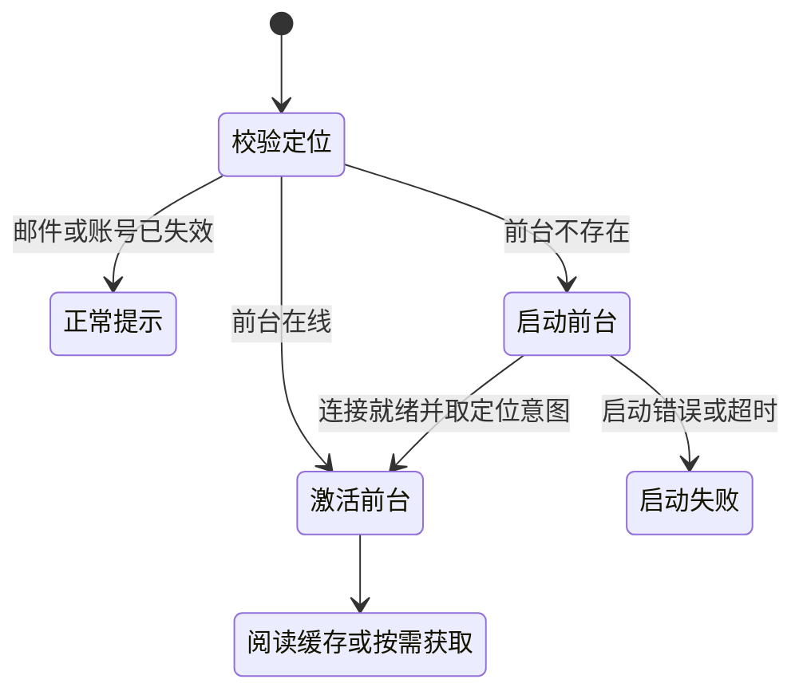

# P4-001 日常使用与桌面集成设计

日期：2026-11-18。状态：设计冻结。通知已由 [P4-002](../reports/P4-002-桌面通知与隐私设置.md) 实施（IPC v2 / schema18）；自启动已由 [P4-003](../reports/P4-003-自启动与桌面生命周期.md) 实施（schema19）；安装包已由 [P4-005](../reports/P4-005-Arch安装包与桌面入口.md) 交付。当前功能开发已完成；尚未完成的真实桌面/系统及持续使用验收见 [项目状态](../项目状态.md)。
依据：[主文档](../../项目构建与开发交接文档.md) §7～10、ADR-0002/0003/0005/0007。P3 用户已验收；证据不足的真实兼容场景仍按原报告标注，不虚构通过。

## 1. 范围与顺序

P4 交付适合个人日常使用的初版；P5 公开发布准备仍保留。本规格记录设计冻结时的范围；实现及schema19状态见项目状态，不以本节的设计顺序表表示仍未开发。

| 迭代 | 交付 | 完成条件 |
| --- | --- | --- |
| P4-001 | 范围、状态与接口设计 | 本规格、状态文档及报告一致 |
| P4-002 | 桌面通知 | 去重、隐私、合并、定位及无服务降级的相关测试通过 |
| P4-003 | 自启动与桌面生命周期 | 可选后台自启动、设置失败反馈、重复启动与退出行为通过 |
| P4-004 | 性能与体验 | 五账号资源测量、空闲重绘、缩放/休眠/网络/电源验证及必要修复 |
| P4-005 | Arch 安装包 | PKGBUILD、桌面入口、图标及安装/升级/卸载验证 |
| P4-006 | 持续使用与收口 | 集中 E2E、阶段全量测试、真实持续使用记录及最终测试包 |

不增加 OAuth（ADR-0002 允许最早 P4 按需启动，并非本轮必做）、通知中心、规则/声音系统、系统级服务、Flatpak、自动更新、会话聚合或整套 GUI 重设计。中文斜体和富文本剪贴板沿用已记录限制，不立项字体或编辑器替换工程。

## 2. 通知产生与持久去重

通知由 daemon 在收件箱索引事务提交后产生，不能由 UI 列表刷新、未读总数变化或 IDLE 唤醒直接触发。`sync_engine`、存储 `publish_folder` 与既有账号调度复用；IDLE 仅提示检查，不代表一封新信。

每账号、收件箱及 UIDVALIDITY 保存通知基线与已处理 UID 高水位；首次成功同步只建立基线，后续仅通知同一 epoch 下高于基线、新增且未读的邮件。历史加载、重建、首次添加、UIDVALIDITY 改变均重新建立基线并抑制该轮通知。UID 较旧邮件重新变未读不产生新信通知。普通重启保留基线；暂停恢复/断网恢复同 epoch 的新增信可合并提醒。索引事务失败不得推进基线或发出通知。

在同一存储事务中登记通知候选和推进基线。后台在外部 D-Bus 调用前将候选持久标记为已尝试，选择“可能漏一次提示，优先不在重启后重复骚扰”的至多一次尝试策略；通知不是可靠邮件投递凭据。D-Bus 超时或结果丢失不自动重放。服务缺失/通知关闭时消费候选，不恢复后补报旧信。异常崩溃窗口及上述边界须在报告中说明。

每账号从首个候选起合并 2 秒后提交一条摘要；连续到信不无限推迟，最多每账号每 10 秒提示一次，后续候选合并下一批。交付摘要只提取至多 20 个定位 ID、准确总数及现有索引字段（002实际只提取单封定位）；待合并候选在数据库临时引用原有UID身份，以准确过滤到达时已读及之后的本地操作，完成即清理，不复制头部/正文；不复制正文，不为预览下载资源。已删除、已读或账号移除的候选在提交前剔除。已尝试记录随高水位压缩，不永久累积邮件级通知表。

默认开启新信通知，仅显示账号与数量。用户可关闭通知，或明确启用发件人/主题；预览单独选择，且只用已经缓存的安全纯文本，未缓存则省略。锁屏时的展示由桌面通知服务决定，应用不承诺检测锁屏或强制隐藏。认证错误、密码、路径、原始 HTML 不进入通知；正文与主题转义为纯文本/规范转义内容，不插入可执行链接或任意图片。

通过会话总线 `org.freedesktop.Notifications` 使用标准 Notify、动作及关闭信号，能力不足时省略动作。缺服务、权限拒绝、调用失败分开显示可理解状态，不阻塞收信，不启动高频探测定时器；服务所有者变化后重新检测。应用无法可靠证明系统弹窗实际显示或勿扰状态，不将调用成功标作用户已看见。

## 3. 点击通知与前台状态

单封通知定位完整邮件身份（账号、文件夹、UIDVALIDITY、UID）；多封摘要打开该账号收件箱，不猜测一封。动作使用不含邮件信息的随机 token，只由 daemon 映射到受控身份；核验通知服务信号来源，过期/未知 token 无操作。token 最长保留 24 小时、全局最多 256 条，替换/关闭即清理；后台重启后旧动作可失效，不从任意命令行或文件路径执行动作。

复用 `ipc/session` 的激活、启动器和同目录 `mail-ui` 启动方式。已有前台则激活；没有前台时暂存一个有界定位意图，启动前台并在 AttachUi 后交付。连续点击采用最新意图，不启动多个前台；启动失败清除启动中状态并显示失败，允许再次操作。前台离线仍可看缓存；未缓存正文按既有阅读状态提示。邮件不存在、epoch 已变或账号已移除则打开邮箱并提示，不错误定位相同 UID。

这条路径只打开与读取，不提交、重发 SMTP，不覆盖编辑器。主窗关闭仍协调保存全部编辑窗口；失败保留窗口，成功退出 GPUI，daemon/托盘继续。托盘“保存并退出”协调退出两个进程。

## 4. 设置归属、数据与协议演进

现有 `mail-ui/settings.rs` 的 `settings.txt` 仅保存明暗、字号、紧凑模式、减少动效等前台偏好；不能让后台和 UI 同时改写此文件。

新桌面偏好与通知基线由 daemon 经现有 Store 单写者持久化。P4-002 从 schema17 顺序增加桌面通知偏好/基线/候选；沿用迁移前备份、事务升级和未来版本拒绝。自启动开关的实际状态来自受管 XDG 文件，数据库只保存最后设置意图及待协调状态，避免文件与数据库假装原子事务。无新秘密、正文副本或凭据存储。

拟新增类型化接口（名称在实现时保持一致）：`DesktopSettings` 读取偏好、修订号和通知/自启动实际状态；`UpdateDesktopSettings` 带持久请求 ID 与预期修订号更新；`OpenMail` 携带完整定位，复用会话激活并让新连接读取待交付意图。事件仍用快照加版本，断线重取，不重放未知写操作。设置响应丢失查询原请求结果；修订冲突刷新后重试，不静默覆盖。

现协议使用严格枚举及 `deny_unknown_fields`，不能以“加字段”推定旧程序兼容。P4-002 明确增加桌面能力与修订握手，旧端不识别新能力/消息时必须在写入前拒绝并提示同时更新 UI 与 daemon；如无法通过现有握手实现这一点则递增协议主版本并记录迁移，不能跳过兼容门禁。安装包始终配套交付两个程序。

UI 设置沿用 M3E 控件，新增“桌面”分组：通知开关、内容隐私选项、登录后后台启动，以及服务/实际启动状态。写入中禁重复提交；保存失败保留原值与原因，提供重试。不另做设置框架或独立通知页面。

## 5. 可选自启动及失败恢复

默认关闭，只由用户明确开启。使用 `$XDG_CONFIG_HOME/autostart/org.qingmail.QingMail.desktop`（未设置时 `~/.config/autostart/`），只执行 `mail-daemon --production`，不打开主窗口；不用 systemd 系统服务，不自动添加前台。

受管条目带 QingMail 管理标记，使用绝对、规范化的可执行路径并按 Desktop Entry 规范编码，不拼接 shell 命令。开启前验证可执行文件；拒绝相对/不存在路径、测试隔离入口。开发或便携目录移动后明确显示路径失效，需重新开启，不能静默指向另一程序。正式安装写 `/usr/bin/mail-daemon --production`，TryExec 同路径。

以同目录临时文件加 rename 原子写入；关闭只移除本应用明确拥有的文件，遇到同名非受管文件报告冲突，不覆盖用户配置。操作遵循幂等请求与持久待协调意图：重启按实际文件内容核对并完成或报告失败。不能仅因数据库开关改变就报告成功；只读目录、权限、磁盘满显示失败，保留可恢复状态。

会话登录的环境应提供会话 D-Bus、Wayland 和 XDG_RUNTIME_DIR；缺失时报告后台未就绪，不创建另一个数据目录。复用 daemon 单实例锁，同一会话已有后台时不重复运行。无托盘宿主时设置/后台状态明确告知“后台仍运行，再次打开应用可返回，保存并退出可停止”；不以托盘注册等同宿主可见。

“保存并退出”只结束本次会话，保留下一次登录启动设置；“关闭登录后后台启动”只更改下次登录行为，不停止当前后台。用户注销不承诺系统给足保存时间，本地草稿继续依赖既有及时落盘，不扩展会话恢复工程。

## 6. Arch 安装布局

| 对象 | 正式安装位置与规则 |
| --- | --- |
| 前台/后台 | `/usr/bin/mail-ui` 与 `/usr/bin/mail-daemon`，保留同目录寻找配套程序 |
| 桌面入口 | `/usr/share/applications/org.qingmail.QingMail.desktop`，Exec 为 `/usr/bin/mail-ui`，终端关闭，分类 Email/Network |
| 图标 | `/usr/share/icons/hicolor/` 标准尺寸或 scalable，名称 `org.qingmail.QingMail` |
| 用户配置/数据/缓存 | 沿用现有 XDG 路径及密钥库关联，安装脚本不迁移、不读取秘密 |
| 自启动 | 仅用户设置创建；安装包不在系统 autostart 目录注册 |

命名使用当前 QingMail 身份，实施时验证 Wayland app_id、desktop 文件及图标关联，不能把现有 Secret Service 的 application 属性误当窗口身份已验证。PKGBUILD 在 P4-005 核实实际链接依赖、字体、Vulkan/Wayland、会话总线与 Secret Service；不硬编码 Intel 驱动环境变量为所有用户默认。

升级先协调退出旧进程；无法保存时不能强行结束并宣称成功。既有数据迁移由新版 daemon 完成。卸载保留用户数据、密钥与用户自启动项并说明清理方式；残留自启动用 TryExec 避免失效执行。公开签名、分发资格、完整许可证审查与发布政策属于 P5，基础安装依赖说明属于本轮。

## 7. 性能与体验验收

先测量，再只修复实测瓶颈。默认遵循系统省电策略；流畅度测试使用平衡模式，记录实际电源模式、驱动、显示刷新率和缩放。不以 HUD 的 1/FRAME 推导值证明实际呈现流畅，不固定解除动画省电限制。

| 场景 | 采样与判定 |
| --- | --- |
| 五账号后台空闲 | 可控服务器提供五个稳定连接账号，完成初始同步并稳定至少 5 分钟；连续采样至少 30 分钟，每 5 秒记录进程树 PSS、累计 CPU 时间和任务状态 |
| 预算 | 后台树 PSS 采样最大值 ≤80 MiB；CPU 用总 CPU 增量/墙钟时长计算，平均低于单核 0.5%；记录短峰、IDLE/轮询和周期维护，不挑掉周期工作 |
| 非空闲 | 新信、历史索引、下载、草稿上传分别记录峰值和恢复时间，不与空闲预算混写 |
| 前台 | 静止窗口不持续重绘；固定一万封合成索引分页/搜索/快速切信时记录输入与列表响应，目标无可感知卡顿，附样本/步骤/帧间隔，不能只报平均 FPS |
| 关闭 | 确认 GPUI 已退出，后台继续；系统浏览器单列，不混入后台资源或隐去成本 |
| 显示 | 100/125/150/200% 缩放，窄窗/平铺/跨屏，焦点、中文输入、选区及主要控件可用 |
| 环境恢复 | 休眠/恢复、断网/联网、网络切换、省电/平衡切换后无忙轮询、无重复 SMTP；通知服务/托盘缺失不阻塞 |

真实账号仅一个时不宣称五个真实服务商已验证。现有 P3 的短时 8MiB/2秒 CPU 数据仅作起点。五账号空闲预算失败先定位连接/定时器/解析/图形成本；改预算必须另行说明依据，不能自动放宽。

## 8. 验证与退出标准

日常只运行受影响的单元/存储/协议/桌面模拟测试及 fmt/check/clippy；P4-001 纯文档只检查链接与差异，不编译或运行 Rust 测试。P4-002 重点覆盖首次/历史/重复/epoch/重启、事务失败、D-Bus响应丢失、隐私与点击失效；P4-003 覆盖文件冲突、失败恢复、重复后台与保存失败。P4-005 覆盖干净安装、配套升级、卸载保留数据。

P4-006 进行一次集中端到端、一次工作区全量测试，修复后只补跑相关测试；记录建议连续 7 天的真实使用区间及中断，不能用短时自动化冒充持续试用。合并验证多账号/离线/草稿/资源/缓存与桌面集成；接续 P3 尚无真实证据的场景，区分模拟和真实。真实 SMTP 发送仍需用户明确授权，之前仅收信/草稿授权不扩展为发送。

退出需桌面通知和自启动状态可理解、安装升级可用、性能报告含完整条件、持续使用无阻断性丢数据/重复发送问题，并有 UI+daemon 配套测试包、迁移和已知限制说明。未测事项明确标记，不以用户接受替代不存在的测试记录。
